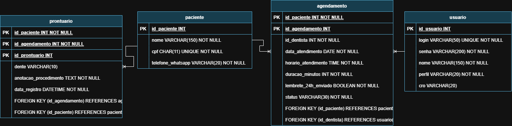

# Dr. Roberto — Sorriso Metálico  Cliente: Dr. Roberto Carlos de Alencar e Silva (Sorriso Metálico Odontologia de Excelência LTDA).  
Objetivo: Controlar a agenda clínica e o atendimento dos dentistas, com cadastro simples de pacientes por CPF, anotação de prontuário em campo livre e disparo automático de lembretes de consulta 24 horas antes pelo WhatsApp.  
# Mer 
paciente
- id_paciente PK
- nome VARCHAR(150)
- cpf CHAR(11)
- telefone_whatsapp VARCHAR(20)

usuario
- id_usuario PK
- login VARCHAR(50)
- senha VARCHAR(200)
- nome VARCHAR(150)
- perfil VARCHAR(20)
- cro VARCHAR(20)

agendamento
- id_agendamento PK
- id_paciente FK
- id_dentista FK
- data_atendimento DATE
- horario_atendimento TIME
- duracao_minutos INT
- lembrete_24h_enviado BOOLEAN
- status VARCHAR(30)

prontuario
- id_prontuario PK
- id_agendamento FK
- id_paciente FK
- dente VARCHAR(10)
- anotacao_procedimento TEXT
- data_registro DATETIME

relacionamento
- 1 paciente para varios agendamento
- 1 usuario para varios agendamento
- 1 agendamento para 1 prontuario
- 1 paciente para varios prontuario
# Der
